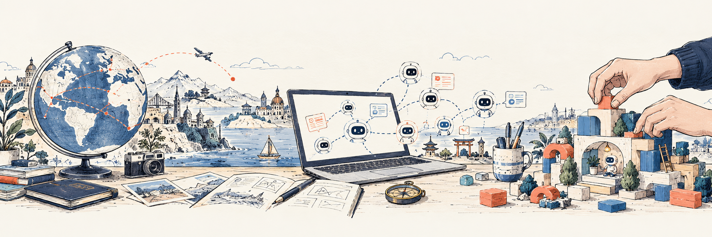

# Hello there! 👋 I am Ruby!
**AI × Global Growth × Human-Centered Creation**

> I build at the intersection of AI, global growth, and human possibility.

### Currently exploring

- AI-native workflows
- Global growth and cross-border creation
- Human-centered collaboration

关于 Ruby 🧭

Ruby 拥有国际经济与贸易专业背景，曾深度参与 B2B、B2C、DTC 等跨境出海业务，擅长统筹项目从规划、执行到落地与复盘的完整闭环，逐步将实践拓展至全球市场、内容、用户增长与 AI 产品。自 2023 年起 All in AI，持续投入 AI 产品与 Agent 的创造，操盘了 5+ 个 Agent 项目；同时作为 AdventureX 黑客松的早期共建成员，参与推动创作者与独立开发者从想法走向实践。

**Get your hands dirty. 亲自下场，把想法做出来。**

我从国际化与跨境业务出发，慢慢走进全球市场、内容、用户增长和 AI 产品。一路走来，我越来越确定，真正吸引我的并不是某一个职位标签，而是把一个模糊的想法，变成有人愿意使用、愿意相信、愿意继续参与的真实事物。

我喜欢站在不同世界的交界处：用户与产品之间，技术与市场之间，直觉与数据之间，个人表达与群体协作之间。我的工作经常从一个问题开始——人们真正想完成什么？他们为什么还没有完成？我们能不能把复杂的事情变得更清楚、更有趣，也更容易开始？

过去的经历让我同时拥有几种视角：理解跨境商业的现实，理解内容和社交传播的语言，理解增长从获取到留存的完整路径，也理解 AI 正在如何改变产品、工作流和人与人的协作方式。相比把自己定义成某一种角色，我更愿意成为一名连接者：把洞察翻译成叙事，把叙事变成行动，把行动变成可以被验证的结果。

我尤其喜欢 0 到 1 的阶段。资源有限、答案不完整、每一步都需要自己弄清楚的时候，反而最接近创造本身。我愿意亲自做研究、写内容、搭流程、看数据、和用户交流，也愿意与工程、设计和业务伙伴一起把事情推到真实世界里。对我来说，执行不是创意的后半段，执行本身就是理解问题的一种方式。

我相信 AI 时代最稀缺的能力，不只是知道更多，而是能够更快地理解、更深地思考，并且把想法扎实地做出来。AI 可以放大一个人的速度，但只有清晰的判断、真实的同理心和持续的行动，才能决定这种速度最终会把我们带向哪里。

我希望未来持续创造这样的东西：让人变得更有能力，让工作变得更有意义，让全球不同地方的人更容易理解彼此，也让更多好的想法有机会跨越语言、地域和资源的边界。

我还在路上——一边探索世界，一边探索如何用技术和创造力，让世界因为我的参与而多一点连接、多一点可能。

About Ruby 🌍

Ruby has an academic background in International Economics and Trade and extensive hands-on experience in B2B, B2C, and DTC cross-border business. She excels at managing projects through the full cycle of planning, execution, delivery, and review, and has expanded her work into global markets, content, user growth, and AI products. Since going all in on AI in 2023, she has led 5+ Agent projects. As an early co-builder of the AdventureX hackathon, she also helps creators and indie developers turn ideas into practice.

**Get your hands dirty. Step in and bring ideas to life.**

I started with international business and cross-border work, then moved toward global markets, content, user growth, and AI products. Over time, I have become less interested in a single job title and more interested in a deeper question: how do we turn an unclear idea into something real—something people want to use, trust, and keep building with?

I enjoy working at the intersection of different worlds: users and products, technology and markets, intuition and data, individual expression and collective work. Most of my work begins with a human question: what is someone truly trying to accomplish, what is holding them back, and how might we make the next step clearer, more engaging, and easier to begin?

My experience has given me several lenses at once: the realities of cross-border business, the language of content and social distribution, the full path from acquisition to retention, and the way AI is reshaping products, workflows, and collaboration. Rather than being defined by one function, I see myself as a connector—translating insight into narrative, narrative into action, and action into outcomes that can be tested in the real world.

I am drawn to the 0-to-1 stage, when resources are limited, answers are incomplete, and every meaningful step requires curiosity and ownership. I am comfortable researching, writing, designing workflows, reading data, talking with users, and working across disciplines to move an idea forward. To me, execution is not what comes after creativity; it is one of the ways we understand a problem deeply enough to create something worthwhile.

I believe the most valuable capability in the AI era is not simply knowing more. It is the ability to understand faster, think more deeply, and turn ideas into grounded action. AI can amplify speed, but clear judgment, genuine empathy, and sustained effort determine where that speed takes us.

I want to keep building things that make people more capable, make work more meaningful, and make it easier for good ideas to cross languages, borders, and differences in resources. I am still on the way—exploring the world while exploring how technology and creativity can create more connection and more possibility.

